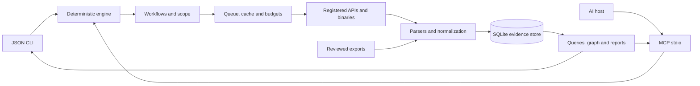

<p align="center">
  
</p>
<h1 align="center">OSINT POWER</h1>
<p align="center"><strong>Discover assets. Preserve evidence. Connect your findings to AI.</strong></p>
<p align="center">
  <a href="https://github.com/jenmar23rondon-ux/OSINT_POWER/actions/workflows/ci.yml"></a>
  <a href="LICENSE"></a>
  <a href="https://nodejs.org/"></a>
  
</p>
<p align="center">
  <a href="#quick-start">Quick start</a> · <a href="docs/WORKFLOWS.md">Seven workflows</a> · <a href="docs/AI.md">Connect AI</a> · <a href="docs/ADAPTERS.md">Adapters</a> · <a href="docs/ROADMAP.md">Roadmap</a>
</p>

OSINT POWER is an evidence-focused reconnaissance framework for scoped security assessments and research. It normalizes public-source observations, stores provenance in SQLite, and exposes a CLI and **nine MCP tools**. It works without a model or an AI API key.

**Status: v0.2.0, initial workflow implementation.** Seven workflows are available with explicit budgets, source status and partial results. External binaries are installed separately. Some sources are supported through imports rather than live connectors; see the matrix below.

## Quick start

Requires **Node.js 24.14+** and Git. The core uses JavaScript ESM and Node's included SQLite.

```bash
git clone https://github.com/jenmar23rondon-ux/OSINT_POWER.git
cd OSINT_POWER
npm ci --ignore-scripts
node src/cli.js demo
npm test
```

The demo uses only synthetic example.com and documentation IP fixtures. It sends no traffic and returns **4 entities and 2 relationships**. Node 24 may print an experimental SQLite warning to stderr; stdout remains valid JSON.

```bash
node src/cli.js init
node src/cli.js import --adapter subfinder --file examples/subdomains.txt
node src/cli.js query --type domain --limit 25
node src/cli.js graph
node src/cli.js report
```

`init` never overwrites an existing configuration. The default configuration disables network access and active collection. State is stored alongside the configuration in `.osint-power/state.sqlite`.

## Seven workflows

| Workflow      | What it does                                                                                                        |
| ------------- | ------------------------------------------------------------------------------------------------------------------- |
| `people`      | Generate candidate aliases for a declared professional subject; bounded Sherlock/GitHub lookups and sourced context |
| `company`     | Passive discovery, configured DNS/HTTP checks, registry/routing context and public business evidence                |
| `places`      | Link reviewed public corporate office evidence to the company                                                       |
| `users`       | Derive candidate aliases from corporate emails without treating matches as identity confirmation                    |
| `emails`      | Collect/import addresses, check syntax and DNS MX, then query configured HIBP accounts                              |
| `exposures`   | Summarize breach associations and imported secret locations without retaining secret values                         |
| `correlation` | Review provenance, uncertainty and defensive priorities for the company                                             |

```bash
node src/cli.js workflow --workflow company --target example.com
node src/cli.js workflow --workflow company --target example.com --execute --max-targets 3 --max-calls 10
```

Replace the example with your configured scope. Without `--execute`, workflows only plan and read local state. Execution respects the existing configuration, quotas and cache. Missing connectors, inputs and dependencies remain visible in the result.

**[Workflow guide, offline examples and source limitations](docs/WORKFLOWS.md)**.

## Capabilities

- Strict validated inputs and a common observation contract: type, value, source, confidence, timestamp and evidence.
- SQLite entities, observations, relationships, run history and TTL cache.
- SHA-256 deduplication; repeated evidence is not counted as independent corroboration.
- Sequential collection per process, timeout, byte/record limits, shell-free argument arrays and bounded HTTP retries.
- Small pages for AI, evidence on demand and three ranked next actions.
- Relationships with provenance: company → domain → IP → URL; professional subject → candidate alias → profile; company → public office.
- Source confidence is a heuristic assessment, not calibrated probability or verified ownership.

## Configure collection

Edit `config.json` with domains, exclusions and limits. Enable `network` for remote collection. DNS/HTTP/port collection also requires `active: true` and the corresponding adapter in `enabledAdapters`.

```json
{
  "version": 1,
  "scope": {
    "domains": ["example.com"],
    "excludeDomains": ["excluded.example.com"],
    "ips": [],
    "emails": [],
    "usernames": [],
    "documents": []
  },
  "network": true,
  "active": false,
  "enabledAdapters": ["crtsh", "subfinder"],
  "limits": { "minIntervalMs": 1500, "attempts": 3 }
}
```

```bash
node src/cli.js run --adapter crtsh --target example.com
node src/cli.js pipeline --target example.com
```

The legacy pipeline runs configured crt.sh/subfinder/Amass collectors only. Workflows organize additional stages. A discovered IP or ASN never automatically expands active scope.

## Integrations and actual support

| Source                                                                                                         | v0.2 support                                              | Requirements and limitations                                                          |
| -------------------------------------------------------------------------------------------------------------- | --------------------------------------------------------- | ------------------------------------------------------------------------------------- |
| [crt.sh](https://crt.sh/)                                                                                      | Certificate API                                           | Certificate names are not proof of ownership                                          |
| [subfinder](https://github.com/projectdiscovery/subfinder)                                                     | Execute and import TXT/JSONL                              | Binary on PATH; native upstream provider configuration                                |
| [Amass](https://github.com/owasp-amass/amass)                                                                  | Legacy enum -passive interface and name imports           | Verify flags in your installed version; disabled by default                           |
| [dnsx](https://github.com/projectdiscovery/dnsx)                                                               | Execute/import A/AAAA JSONL                               | Active mode; one host per collection call                                             |
| [httpx](https://github.com/projectdiscovery/httpx)                                                             | Execute/import JSONL                                      | ProjectDiscovery binary; status, tech, title and TLS CN/issuer; no redirect following |
| [naabu](https://github.com/projectdiscovery/naabu)                                                             | TCP connect and JSONL imports                             | Active mode; at most 20 configured ports                                              |
| DNS MX                                                                                                         | Native Node resolver                                      | Mailbox validity and catch-all remain unknown                                         |
| RDAP / [IANA](https://data.iana.org/rdap/ipv4.json)                                                            | Bootstrap and allowlisted RIR queries                     | Registered networks are not office locations or scope grants                          |
| [RIPEstat](https://stat.ripe.net/docs/data-api/api-endpoints/network-info)                                     | Prefix and origin ASN API                                 | Routing information is not ownership                                                  |
| [GitHub profiles](https://docs.github.com/en/rest/users/users#get-a-user)                                      | Public API by scoped alias                                | Public company/email claims are unverified source assertions                          |
| [Sherlock](https://github.com/sherlock-project/sherlock)                                                       | Bounded execution and CSV import                          | One alias, 1–3 configured professional sites, binary on PATH                          |
| [theHarvester](https://github.com/laramies/theHarvester)                                                       | Bounded execution and JSON import                         | Configured crtsh/certspotter sources; field coverage depends on source                |
| [WhatsMyName](https://github.com/WebBreacher/WhatsMyName)                                                      | Import bridge                                             | Dataset, not an invented executable; username/url/status contract                     |
| [ExifTool](https://exiftool.org/)                                                                              | JSON metadata import                                      | Allowed document; selected metadata fields, no automatic GPS inference                |
| [Gitleaks](https://github.com/gitleaks/gitleaks) / [TruffleHog](https://github.com/trufflesecurity/trufflehog) | Report imports                                            | File/rule/line only; raw values and scanner verification claims discarded             |
| [HIBP](https://haveibeenpwned.com/API/v3)                                                                      | Breach name/date API                                      | Exact scoped account and HIBP_API_KEY; no passwords                                   |
| DeHashed / LeakCheck                                                                                           | Strict breach-summary imports                             | Metadata only; no password retrieval or live connectors                               |
| [recon-ng](https://github.com/lanmaster53/recon-ng) / [SpiderFoot](https://github.com/smicallef/spiderfoot)    | Common-schema JSONL bridge                                | Native export conversion required; no module execution                                |
| LinkedIn / X / job listings / public office records                                                            | Search-query handoff and sourced business-context imports | No automated scraping or fabricated search results                                    |

External projects are not bundled or relicensed. Their versions and API availability affect compatibility. OCR, historical DNS, global code/paste search, geocoding and Nuclei execution remain outside this release.

## Connect an AI host

The MCP server uses stdio. Register it with your compatible host using absolute paths:

```json
{
  "mcpServers": {
    "osint-power": {
      "command": "node",
      "args": ["/absolute/path/OSINT_POWER/src/mcp.js"],
      "env": { "OSINT_POWER_CONFIG": "/absolute/path/OSINT_POWER/config.json" }
    }
  }
}
```

Adapt registration to your host's format. See [AI integration](docs/AI.md) and the [agent template](docs/AGENT_PROMPT.md).

| MCP tool           | Purpose                                           |
| ------------------ | ------------------------------------------------- |
| `capabilities`     | Configured scope, adapters, workflows and limits  |
| `collect`          | One validated adapter/target pair                 |
| `passive_pipeline` | Sequential passive discovery with partial results |
| `import_findings`  | Normalize a bounded supplied export               |
| `query_findings`   | Stable entity pages and provenance summary        |
| `get_evidence`     | Untrusted observations for a specific entity      |
| `get_graph`        | Evidence-backed relationships                     |
| `workflow`         | Plan or execute a bounded workflow                |
| `get_report`       | Bounded report, history and next actions          |

The model reasons about the evidence; the core handles parsing, validation and storage. Evidence text cannot change the configured scope or become a shell command.

## Data contract

```json
{
  "type": "domain",
  "value": "api.example.com",
  "source": "crtsh",
  "confidence": 0.8,
  "timestamp": "2026-11-07T00:00:00.000Z",
  "evidence": { "record": "12345" }
}
```

Domains, IDNs, IPs, emails and URLs are normalized. URL query strings and fragments are removed. Out-of-scope records are counted as `skipped`, malformed rows as `invalid`, and record limits as `truncated`. Ambiguity can be imported as `unresolved` with a related in-scope host.

The highest source confidence is shown without automatically adding overlapping sources. A username match, open port, MX record or breach association does not prove identity, exploitability, mailbox existence or current credential validity.

## Architecture



## Development

```bash
npm ci --ignore-scripts
npm test
npm run lint
npm run schema
npm audit
```

CI covers Windows and Linux. Tests use synthetic fixtures, mocked network sources, bounded local subprocesses and a real MCP client/server session. They do not certify every upstream binary version. See [CONTRIBUTING.md](CONTRIBUTING.md).

The [Dockerfile](docker/Dockerfile) runs the core as an unprivileged user. It does not bundle reconnaissance binaries or impose a provider-specific egress policy; configure resource and network limits on the host.

## Author and license

Created by **Jenmar Rondon** · [GitHub profile](https://github.com/jenmar23rondon-ux) · [OSINT_POWER repository](https://github.com/jenmar23rondon-ux/OSINT_POWER).

**[MIT License](LICENSE)** — Copyright © 2026 Jenmar Rondon. Preserve the original copyright and license notice when redistributing. The README banner is the image supplied for this project.

[Scope and data handling](docs/SCOPE.md) · [Security reporting](SECURITY.md) · [Roadmap](docs/ROADMAP.md).
