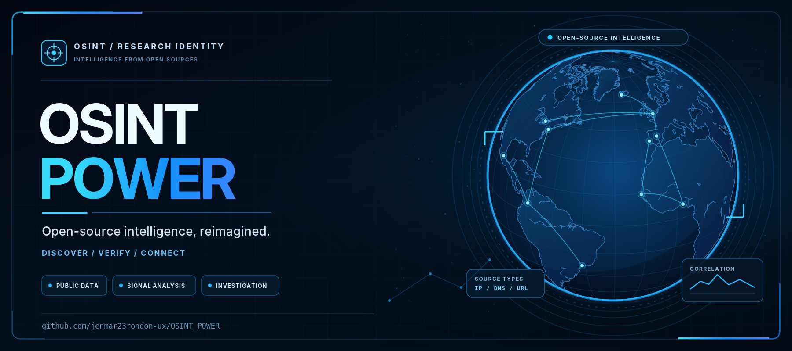
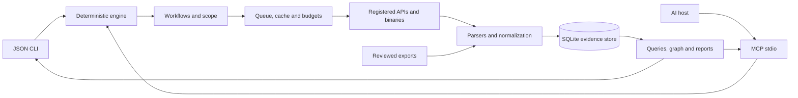

<p align="center">
  
</p>
<h1 align="center">OSINT POWER</h1>
<p align="center"><strong>Discover assets. Preserve evidence. Connect your findings to AI.</strong></p>
<p align="center">
  <a href="https://github.com/jenmar23rondon-ux/OSINT_POWER/actions/workflows/ci.yml"></a>
  <a href="LICENSE"></a>
  <a href="https://nodejs.org/"></a>
  
</p>
<p align="center">
  <a href="#quick-start">Quick start</a> · <a href="docs/WORKFLOWS.md">Seven workflows</a> · <a href="docs/AI.md">Connect AI</a> · <a href="docs/ADAPTERS.md">Adapters</a> · <a href="docs/ROADMAP.md">Roadmap</a>
</p>

OSINT POWER is an evidence-focused reconnaissance framework for scoped security assessments and research. It normalizes public-source observations, stores provenance in SQLite, and exposes a CLI and **47 MCP tools**. It works without a model or an AI API key.

**Status: v0.4.0, historical discovery and verifiable evidence packages.** Seven workflows include explicit budgets, source status and partial results. External binaries are installed separately. Live connectors and import bridges are distinguished in the matrix below.

## What is new in v0.4

- **Cert Spotter and Wayback CDX:** one bounded provider page per call, persistent continuation, explicit restart and historical URL relationships.
- **Precise AI responses:** a separate output contract for each MCP tool; execution, collection completeness and retryability are explicit.
- **Evidence packages:** deterministic exports with normalized excerpts, provenance, configuration digests and offline integrity verification.
- **Measurable quality:** 52 labeled synthetic scenarios covering scope, duplicates, shared infrastructure, identity ambiguity, conflicting assertions, stale records, monitor diffs, cross-source attribution, hypothesis evaluation, out-of-scope bait and secret-leak traps. The scores are synthetic and have not been independently reviewed by humans.
- **Evidence assessments:** `explain_entity` still separates existence, ownership, identity and freshness. `assess` / `assess_evidence` adds a cross-source reading for in-scope assets. The planner exposes observed source novelty and request cost.

See the **[v0.4 guide and migration notes](docs/V0.4.md)**.

Inspect authorized JPEG, PNG, WebP, or TIFF files locally for exact hashes, dimensions, and selected metadata. Use `analyze-image` in the CLI or `analyze_image` with supplied bytes in MCP. [Visual and identity evidence guide](docs/VISUAL-IDENTITY.md)

Use `compare-images` for local perceptual comparison and `ocr-image` for text extraction with installed Tesseract language data. [Commands and limits](docs/VISUAL-IDENTITY.md#compare-images-and-extract-text)

Use `timeline` or MCP `temporal_graph` to read stored DNS, HTTP, and Wayback relationships for a host or reverse DNS history for an IP. Set the observation window and a knowledge cutoff to reconstruct what the workspace knew at that time. [Temporal graph commands and examples](docs/OPERATIONS.md#temporal-network-graph)

Analyst decisions are stored beside that evidence. A shared name or handle, including the same handle on a GitHub profile and in an email address, stays a **candidate** until a non-name identifier is supported by independent sources. Mirrors, a shared upstream, and the same collector run do not count as separate corroboration.

`assess` reads those stored rows and separates historical existence, current activity, organization attribution, conflicts and the analyst decision. It does not collect. A shared IP, CDN or hosting ASN is not ownership, and a certificate or Wayback capture is not proof the name is active. The suggested next step is not executed.

`hypothesis` and `case` read those same stored rows. A hypothesis can be `open`, `supported-pending-review`, `weakened`, `rejected`, or `analyst-confirmed`. Only an explicit analyst close stores `analyst-confirmed`, and none of those statuses is a finding. Evaluation does not collect. A next step that needs network, active mode, or an adapter is labeled and left unexecuted. The case report keeps analyst decisions, candidates, hypotheses and limitations in separate sections.

```bash
node src/cli.js assess --type domain
node src/cli.js assess --id ENTITY_HASH
```

Suspicious lookalikes of an in-scope apex are a separate workflow. They are stored as **suspected** leads, with the basis for each signal, and they are not confirmed phishing. An analyst decision is required before notification or takedown. `export-stix` can turn the stored workspace into a STIX 2.1 bundle; suspected leads stay suspected indicators, and out-of-scope rows are left out. See [production operations](docs/PRODUCTION.md).

```bash
node src/cli.js phishing-scan --target example.com
node src/cli.js phishing-scan --target example.com --execute --max-candidates 10 --max-calls 10
node src/cli.js phishing-report --target example.com --format markdown --output leads.md
```

```bash
node src/cli.js review-queue
node src/cli.js show-entity --id ENTITY_HASH
node src/cli.js decide --subject entity --id ENTITY_HASH --decision needs-more-evidence --reason "Shared handle only." --analyst analyst-1
```

A monitor stores one in-scope investigation, the sources to repeat, and an interval hint. Nothing in this project runs it on a timer: call `monitor run` from cron or CI. Each run re-checks scope, uses only sources the current configuration allows, and writes a local diff. New entities stay unreviewed. Alerts are local JSON or Markdown. A webhook is off unless you set one, and it is not contacted while network access is disabled.

```bash
node src/cli.js monitor add --name edge --workflow company --target example.com --sources crtsh,naabu --interval 24h
node src/cli.js monitor run --id MONITOR_UUID
node src/cli.js monitor diff --id MONITOR_UUID --format markdown --output changes.md
```

Removal means the asset was absent from this run's comparable observations, not that it was deleted. Skipped or failed sources are coverage gaps. A certificate name, MX record, or open port is not ownership, a mailbox, or a confirmed vulnerability.

## Quick start

Requires **Node.js 24.14+** and Git. The core uses JavaScript ESM and Node's included SQLite.

```bash
git clone https://github.com/jenmar23rondon-ux/OSINT_POWER.git
cd OSINT_POWER
npm ci --ignore-scripts
node src/cli.js demo
npm test
```

The demo uses only synthetic example.com and documentation IP fixtures. It sends no traffic and returns **4 entities and 2 relationships**. Node 24 may print an experimental SQLite warning to stderr; stdout remains valid JSON.

```bash
node src/cli.js init
node src/cli.js import --adapter subfinder --file examples/subdomains.txt
node src/cli.js query --type domain --limit 25
node src/cli.js graph
node src/cli.js report
```

`init` never overwrites an existing configuration. The default configuration disables network access and active collection. State is stored alongside the configuration in `.osint-power/state.sqlite`.

## Reliable investigations

Durable jobs resume from checkpoints, use shared SQLite worker leases, and support cancellation. Each execution segment seals an immutable evidence snapshot for comparison. Provider budgets, cooldowns and Retry-After survive process restarts.

```bash
node src/cli.js doctor
node src/cli.js plan --workflow company --target example.com
node src/cli.js workflow --workflow company --target example.com --queue
node src/cli.js resume --id JOB_UUID
node src/cli.js compare --before SNAPSHOT_UUID --after SNAPSHOT_UUID
node src/cli.js report --format html --output investigation.html
```

The offline HTML report includes inventory filters, a selectable graph, entity details, timeline and provider health. Comparisons distinguish new/changed evidence, unobserved records and coverage gaps. They never equate a failed source with asset removal.

See **[operations, recovery limits and snapshot semantics](docs/OPERATIONS.md)** before running long investigations.

## Historical discovery and evidence export

Enable `certspotter` and `wayback` in `enabledAdapters` and set `network: true` for remote discovery. Each invocation consumes one provider page. Continue with the same command; cursors survive restarts. Cert Spotter optionally reads `CERTSPOTTER_API_KEY` from the environment.

```bash
node src/cli.js run --adapter certspotter --target example.com
node src/cli.js run --adapter wayback --target example.com
node src/cli.js run --adapter wayback --target example.com --restart
node src/cli.js bundle --id SNAPSHOT_UUID --output evidence.json
node src/cli.js verify-bundle --file evidence.json
node src/cli.js export-stix --target example.com --output bundle.json
node src/cli.js validate-stix --file bundle.json
npm run benchmark
```

Archived records preserve capture dates and never establish live availability. Incremental pages remain incomplete coverage for run comparisons. Bundles contain selected normalized evidence, not complete downloaded pages or documents. Integrity hashes detect modification; they do not authenticate a publisher.

## Seven workflows

| Workflow      | What it does                                                                                                        |
| ------------- | ------------------------------------------------------------------------------------------------------------------- |
| `people`      | Generate candidate aliases for a declared professional subject; bounded Sherlock/GitHub lookups and sourced context |
| `company`     | Passive discovery, configured DNS/HTTP checks, registry/routing context and public business evidence                |
| `places`      | Link reviewed public corporate office evidence to the company                                                       |
| `users`       | Derive candidate aliases from corporate emails without treating matches as identity confirmation                    |
| `emails`      | Collect/import addresses, check syntax and DNS MX, then query configured HIBP accounts                              |
| `exposures`   | Summarize breach associations and imported secret locations without retaining secret values                         |
| `correlation` | Review provenance, uncertainty and defensive priorities for the company                                             |

```bash
node src/cli.js workflow --workflow company --target example.com
node src/cli.js workflow --workflow company --target example.com --execute --max-targets 3 --max-calls 10
```

Replace the example with your configured scope. Without `--execute`, workflows only plan and read local state. Execution respects the existing configuration, quotas and cache. Missing connectors, inputs and dependencies remain visible in the result.

**[Workflow guide, offline examples and source limitations](docs/WORKFLOWS.md)**.

## Capabilities

- Strict validated inputs and a common observation contract: type, value, source, confidence, timestamp and evidence.
- SQLite entities, observations, relationships, run history and TTL cache.
- SHA-256 deduplication; repeated evidence is not counted as independent corroboration.
- Sequential collection per process, timeout, byte/record limits, shell-free argument arrays and bounded HTTP retries.
- Small pages for AI, evidence on demand and three ranked next actions.
- Relationships with provenance: company → domain → IP → URL; professional subject → candidate alias → profile; company → public office.
- Source confidence is a heuristic assessment, not calibrated probability or verified ownership.

## Configure collection

Edit `config.json` with domains, exclusions and limits. Enable `network` for remote collection. DNS/HTTP/port collection also requires `active: true` and the corresponding adapter in `enabledAdapters`.

```json
{
  "version": 1,
  "scope": {
    "domains": ["example.com"],
    "excludeDomains": ["excluded.example.com"],
    "ips": [],
    "emails": [],
    "usernames": [],
    "documents": []
  },
  "network": true,
  "active": false,
  "enabledAdapters": ["crtsh", "subfinder"],
  "limits": { "minIntervalMs": 1500, "attempts": 3 }
}
```

```bash
node src/cli.js run --adapter crtsh --target example.com
node src/cli.js pipeline --target example.com
```

The legacy pipeline runs configured crt.sh/subfinder/Amass collectors only. Workflows organize additional stages. A discovered IP or ASN never automatically expands active scope.

## Integrations and actual support

| Source                                                                                                         | Current support                                           | Requirements and limitations                                                                         |
| -------------------------------------------------------------------------------------------------------------- | --------------------------------------------------------- | ---------------------------------------------------------------------------------------------------- |
| [crt.sh](https://crt.sh/)                                                                                      | Certificate API                                           | Certificate names are not proof of ownership                                                         |
| [Cert Spotter](https://sslmate.com/help/reference/ct_search_api_v1)                                            | Direct CT API and imports                                 | Persistent `after` cursor; one page per call; optional environment key; searches unexpired issuances |
| [Wayback CDX](https://github.com/internetarchive/wayback/blob/master/wayback-cdx-server/README.md)             | Direct historical URL index and imports                   | Persistent resume key; dates retained; no archived content downloads or live checks                  |
| [subfinder](https://github.com/projectdiscovery/subfinder)                                                     | Execute and import TXT/JSONL                              | Binary on PATH; native upstream provider configuration                                               |
| [Amass](https://github.com/owasp-amass/amass)                                                                  | Legacy enum -passive interface and name imports           | Verify flags in your installed version; disabled by default                                          |
| [dnsx](https://github.com/projectdiscovery/dnsx)                                                               | Execute/import A/AAAA JSONL                               | Active mode; one host per collection call                                                            |
| [httpx](https://github.com/projectdiscovery/httpx)                                                             | Execute/import JSONL                                      | ProjectDiscovery binary; status, tech, title and TLS CN/issuer; no redirect following                |
| [naabu](https://github.com/projectdiscovery/naabu)                                                             | TCP connect and JSONL imports                             | Active mode; at most 20 configured ports                                                             |
| DNS MX                                                                                                         | Native Node resolver                                      | Mailbox validity and catch-all remain unknown                                                        |
| RDAP / [IANA](https://data.iana.org/rdap/ipv4.json)                                                            | Bootstrap and allowlisted RIR queries                     | Registered networks are not office locations or scope grants                                         |
| [RIPEstat](https://stat.ripe.net/docs/data-api/api-endpoints/network-info)                                     | Prefix and origin ASN API                                 | Routing information is not ownership                                                                 |
| [GitHub profiles](https://docs.github.com/en/rest/users/users#get-a-user)                                      | Public API by scoped alias                                | Public company/email claims are unverified source assertions                                         |
| [Sherlock](https://github.com/sherlock-project/sherlock)                                                       | Bounded execution and CSV import                          | One alias, 1–3 configured professional sites, binary on PATH                                         |
| [theHarvester](https://github.com/laramies/theHarvester)                                                       | Bounded execution and JSON import                         | Configured crtsh/certspotter sources; field coverage depends on source                               |
| [WhatsMyName](https://github.com/WebBreacher/WhatsMyName)                                                      | Import bridge                                             | Dataset, not an invented executable; username/url/status contract                                    |
| [ExifTool](https://exiftool.org/)                                                                              | JSON metadata import                                      | Allowed document; selected metadata fields, no automatic GPS inference                               |
| [Gitleaks](https://github.com/gitleaks/gitleaks) / [TruffleHog](https://github.com/trufflesecurity/trufflehog) | Report imports                                            | File/rule/line only; raw values and scanner verification claims discarded                            |
| [HIBP](https://haveibeenpwned.com/API/v3)                                                                      | Breach name/date API                                      | Exact scoped account and HIBP_API_KEY; no passwords                                                  |
| DeHashed / LeakCheck                                                                                           | Strict breach-summary imports                             | Metadata only; no password retrieval or live connectors                                              |
| [recon-ng](https://github.com/lanmaster53/recon-ng) / [SpiderFoot](https://github.com/smicallef/spiderfoot)    | Common-schema JSONL bridge                                | Native export conversion required; no module execution                                               |
| LinkedIn / X / job listings / public office records                                                            | Search-query handoff and sourced business-context imports | No automated scraping or fabricated search results                                                   |
| Phishing lookalikes                                                                                            | Offline variants plus passive enrichment of those names   | In-scope apex only. Suspected, never auto-confirmed. No kit download, form submit, or credential use |

External projects are not bundled or relicensed. Their versions and API availability affect compatibility. OCR, historical DNS, global code/paste search, geocoding and Nuclei execution remain outside this release.

## Connect an AI host

The MCP server uses stdio. Register it with your compatible host using absolute paths:

```json
{
  "mcpServers": {
    "osint-power": {
      "command": "node",
      "args": ["/absolute/path/OSINT_POWER/src/mcp.js"],
      "env": { "OSINT_POWER_CONFIG": "/absolute/path/OSINT_POWER/config.json" }
    }
  }
}
```

Adapt registration to your host's format. See [AI integration](docs/AI.md) and the [agent template](docs/AGENT_PROMPT.md).

| MCP tool                                       | Purpose                                                                                  |
| ---------------------------------------------- | ---------------------------------------------------------------------------------------- |
| `capabilities`                                 | Configured scope, adapters, workflows and limits                                         |
| `collect`                                      | One validated adapter/target pair                                                        |
| `passive_pipeline`                             | Sequential passive discovery with partial results                                        |
| `import_findings`                              | Normalize a bounded supplied export                                                      |
| `query_findings`                               | Stable entity pages and provenance summary                                               |
| `get_evidence`                                 | Untrusted observations for a specific entity                                             |
| `get_graph`                                    | Evidence-backed relationships                                                            |
| `workflow`                                     | Plan or execute a bounded workflow                                                       |
| `start_workflow` / `resume_run` / `cancel_run` | Queue, resume and cancel durable jobs                                                    |
| `get_job` / `list_jobs`                        | Inspect checkpoints and worker leases                                                    |
| `doctor` / `source_health`                     | Local compatibility and persisted provider state                                         |
| `compare_runs` / `explain_entity`              | Immutable comparisons and provenance                                                     |
| `plan_investigation`                           | Rank configured actions using coverage, freshness and budgets                            |
| `get_report`                                   | Bounded report, history and next actions                                                 |
| `export_evidence`                              | Paginated immutable evidence package with integrity digests                              |
| `export_stix`                                  | Read-only STIX 2.1 bundle of in-scope evidence; suspected leads stay suspected           |
| `run_phishing_workflow`                        | Suspected lookalikes for one in-scope apex; passive enrichment only when execute is true |
| `phishing_report`                              | Unverified CERT-style lead report for stored candidates                                  |

The model reasons about the evidence; the core handles parsing, validation and storage. Evidence text cannot change the configured scope or become a shell command.

## Data contract

```json
{
  "type": "domain",
  "value": "api.example.com",
  "source": "crtsh",
  "confidence": 0.8,
  "timestamp": "2026-11-07T00:00:00.000Z",
  "evidence": { "record": "12345" }
}
```

Domains, IDNs, IPs, emails and URLs are normalized. URL query strings and fragments are removed. Out-of-scope records are counted as `skipped`, malformed rows as `invalid`, and record limits as `truncated`. Ambiguity can be imported as `unresolved` with a related in-scope host.

The highest source confidence is shown without automatically adding overlapping sources. A username match, open port, MX record or breach association does not prove identity, exploitability, mailbox existence or current credential validity.

## Architecture



## Development

```bash
npm ci --ignore-scripts
npm test
npm run lint
npm run benchmark
npm run schema
npm audit
```

CI covers Windows and Linux. Core tests use synthetic fixtures, mocked network sources, bounded local subprocesses and real MCP sessions. A separate Linux native lab downloads checksum-pinned httpx/dnsx/naabu and exercises loopback-only fixtures. It does not certify every upstream version. See [CONTRIBUTING.md](CONTRIBUTING.md).

The benchmark reports entity and relationship precision and recall, per-category scores, false attributions, scope-block rate, export reproducibility and secret-leak count. Its results are regression controls on synthetic fixtures and do not estimate real-world accuracy. See [benchmark design](docs/BENCHMARKS.md).

`graph --case UUID --format html --output graph.html` writes a read-only offline graph. Candidates are not drawn as confirmed. The paginated `graph --limit` command is unchanged.

The [Dockerfile](docker/Dockerfile) runs the core as an unprivileged user. It does not bundle reconnaissance binaries or impose a provider-specific egress policy; configure resource and network limits on the host.

## Author and license

Created by **Jenmar Rondon** · [GitHub profile](https://github.com/jenmar23rondon-ux) · [OSINT_POWER repository](https://github.com/jenmar23rondon-ux/OSINT_POWER).

**[MIT License](LICENSE)** — Copyright © 2026 Jenmar Rondon. Preserve the original copyright and license notice when redistributing. The README banner is the image supplied for this project.

[Scope and data handling](docs/SCOPE.md) · [Security reporting](SECURITY.md) · [Roadmap](docs/ROADMAP.md).
