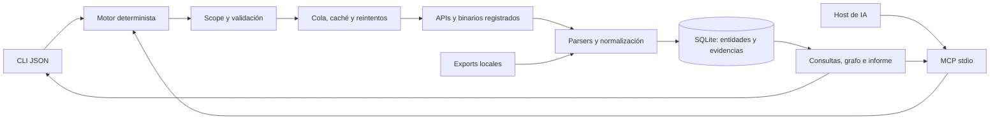

<p align="center">
  
</p>

<h1 align="center">OSINT POWER</h1>
<p align="center"><strong>Descubre activos. Conserva evidencias. Conecta los hallazgos con tu IA.</strong></p>
<p align="center">
  <a href="https://github.com/jenmar23rondon-ux/OSINT_POWER/actions/workflows/ci.yml"></a>
  <a href="LICENSE"></a>
  <a href="https://nodejs.org/"></a>
  
</p>
<p align="center">
  <a href="#inicio-rápido">Instalación</a> · <a href="#integraciones-y-estado-real">Integraciones</a> · <a href="docs/AI.md">Conectar una IA</a> · <a href="docs/ADAPTERS.md">Crear un adaptador</a> · <a href="docs/ROADMAP.md">Roadmap</a>
</p>

OSINT POWER es un framework de reconocimiento para auditorías y proyectos de investigación con alcance configurado. Reúne resultados de distintas fuentes en SQLite, normaliza evidencias y expone herramientas MCP con entradas validadas y respuestas JSON paginadas. Funciona por CLI sin depender de un modelo ni de una API de IA.

**Estado: v0.1.0, primera versión funcional.** Incluye demo sin red y pruebas de integración MCP. Los binarios externos se instalan por separado; sus versiones, cobertura y disponibilidad dependen de cada proyecto. Consulta la matriz antes de habilitarlos.

## Qué aporta

- **Un contrato de datos:** `type`, `value`, `source`, `confidence`, `timestamp`, `evidence` con validación Zod y JSON Schema exportado.
- **Memoria persistente:** entidades, observaciones, relaciones y ejecuciones en SQLite; deduplicación SHA-256 sin contar repeticiones como nuevas pruebas.
- **IA con herramientas concretas:** ocho tools MCP, paginación, evidencia bajo demanda y tres siguientes acciones explicadas en cada iteración.
- **Ejecución acotada:** un trabajo de colección a la vez por proceso, timeout, límite de bytes y registros, argumentos sin shell y límites nativos donde están disponibles.
- **Fuentes independientes del flujo:** caché TTL, hasta tres intentos para errores HTTP transitorios, `Retry-After` y resultados parciales si un proveedor falla.
- **Correlación con procedencia:** dominio → IP → URL y alias → perfil. Las relaciones describen observaciones; no prueban propiedad ni identidad.

## Inicio rápido

Necesitas **Node.js 24.14 o posterior** y Git. Se usa JavaScript ESM y SQLite incluido en Node; no hace falta Python, Neo4j, Docker ni una clave de IA para arrancar.

```bash
git clone https://github.com/jenmar23rondon-ux/OSINT_POWER.git
cd OSINT_POWER
npm ci --ignore-scripts
node src/cli.js demo
npm test
```

La demo usa exclusivamente fixtures de `example.com` y `192.0.2.0/24`: no envía tráfico. Debe devolver **4 entidades**, **2 relaciones** y las ejecuciones de importación. SQLite puede emitir un aviso experimental en stderr en Node 24; stdout conserva JSON válido.

Para guardar resultados y consultar una exportación local:

```bash
node src/cli.js init
node src/cli.js import --adapter subfinder --file examples/subdomains.txt
node src/cli.js query --type domain --limit 25
node src/cli.js graph
node src/cli.js report
```

`init` crea `config.json` sin sobrescribir un archivo existente. El ejemplo empieza con red y reconocimiento activo deshabilitados. El estado se guarda junto a la configuración en `.osint-power/state.sqlite`.

## Recolección sobre tu alcance

Edita `config.json`: reemplaza los dominios de ejemplo, define exclusiones y habilita `network`. Para resolver DNS, consultar HTTP o puertos también necesitas `active: true` y añadir el adaptador a `enabledAdapters`. No se cambia el alcance automáticamente a partir de un resultado.

```json
{
  "version": 1,
  "scope": {
    "domains": ["example.com"],
    "excludeDomains": ["excluded.example.com"],
    "ips": [],
    "emails": [],
    "usernames": [],
    "documents": []
  },
  "network": true,
  "active": false,
  "enabledAdapters": ["crtsh", "subfinder"],
  "limits": { "minIntervalMs": 1500, "attempts": 3 }
}
```

```bash
node src/cli.js run --adapter crtsh --target example.com
node src/cli.js run --adapter subfinder --target example.com
node src/cli.js pipeline --target example.com
```

Estos comandos consultan la red: usa tus dominios configurados. `pipeline` ejecuta solo las fuentes pasivas habilitadas entre crt.sh, subfinder y Amass. Las consultas activas se solicitan una por una. La presencia de una IP compartida en DNS no permite escanear esa IP automáticamente.

## Integraciones y estado real

| Fuente / herramienta                                                                                       | Disponible en v0.1                                                      | Condiciones y límites                                                                      |
| ---------------------------------------------------------------------------------------------------------- | ----------------------------------------------------------------------- | ------------------------------------------------------------------------------------------ |
| [crt.sh](https://crt.sh/)                                                                                  | API de certificados                                                     | Nombres de certificados; no confirma propiedad actual                                      |
| [subfinder](https://github.com/projectdiscovery/subfinder)                                                 | Ejecución e importación TXT/JSONL                                       | Binario en PATH; claves de proveedores en su configuración nativa                          |
| [Amass](https://github.com/owasp-amass/amass)                                                              | Ejecución de interfaz `enum -passive`; importación de nombres TXT/JSONL | Deshabilitado en el ejemplo; verificar compatibilidad de flags de la versión instalada     |
| [dnsx](https://github.com/projectdiscovery/dnsx)                                                           | Ejecución e importación JSONL A/AAAA                                    | Modo activo; un host por llamada                                                           |
| [httpx](https://github.com/projectdiscovery/httpx)                                                         | Ejecución e importación JSONL                                           | Binario de ProjectDiscovery; estado/tecnología, sin seguir redirecciones                   |
| [naabu](https://github.com/projectdiscovery/naabu)                                                         | Ejecución TCP connect e importación JSONL                               | Modo activo; máximo 20 puertos configurados                                                |
| [HIBP](https://haveibeenpwned.com/API/v3)                                                                  | API de nombres de brechas por correo                                    | Cuenta exacta en `scope.emails`, suscripción/clave `HIBP_API_KEY`; no descarga contraseñas |
| [Sherlock](https://github.com/sherlock-project/sherlock)                                                   | Importación CSV nativa de `--csv`                                       | Alias explícito en scope; coincidencia de usuario ≠ identidad                              |
| [theHarvester](https://github.com/laramies/theHarvester)                                                   | Importación JSON con `emails` y `hosts`                                 | Correos y hosts dentro del alcance                                                         |
| [ExifTool](https://exiftool.org/)                                                                          | Importación JSON de `exiftool -j archivo.pdf`                           | Documento permitido; Author, Creator, Producer, Software y Title                           |
| [Gitleaks](https://github.com/gitleaks/gitleaks)                                                           | Importación de informe JSON                                             | Conserva archivo/regla/línea; descarta `Secret` y `Match`                                  |
| [recon-ng](https://github.com/lanmaster53/recon-ng), [SpiderFoot](https://github.com/smicallef/spiderfoot) | Puente de importación mediante nuestro esquema JSONL                    | No ejecuta sus módulos ni interpreta todos sus formatos nativos                            |

No se empaquetan ni se redistribuyen estos proyectos. Cada herramienta conserva su licencia. No hay OCR, scraping de LinkedIn, consultas de DNS histórico, Hunter, búsquedas de GitHub ni ejecución de Nuclei implementadas en esta versión. Están separadas en el [roadmap](docs/ROADMAP.md).

## Una IA puede usarlo

El servidor habla MCP por stdio y se conecta a un host compatible. La IA aporta el razonamiento; el framework valida parámetros, ejecuta adaptadores, persiste y pagina. No exige una cuenta de un proveedor de modelos.

```json
{
  "mcpServers": {
    "osint-power": {
      "command": "node",
      "args": ["/ruta/absoluta/OSINT_POWER/src/mcp.js"],
      "env": {
        "OSINT_POWER_CONFIG": "/ruta/absoluta/OSINT_POWER/config.json"
      }
    }
  }
}
```

Usa rutas absolutas; en JSON de Windows escapa `\\`. Adapta el bloque al formato de tu host. Documentación completa y política de agente en [docs/AI.md](docs/AI.md); plantilla de trabajo en [docs/AGENT_PROMPT.md](docs/AGENT_PROMPT.md).

| Tool MCP           | Función                                                                |
| ------------------ | ---------------------------------------------------------------------- |
| `capabilities`     | Consultar scope, modos y límites configurados                          |
| `collect`          | Una fuente y un objetivo validados                                     |
| `passive_pipeline` | Fuentes pasivas secuenciales con resultados parciales                  |
| `import_findings`  | Normalizar un export proporcionado, sin leer rutas locales arbitrarias |
| `query_findings`   | Entidades paginadas, fuentes y confianza                               |
| `get_evidence`     | Evidencias paginadas de una entidad                                    |
| `get_graph`        | Relaciones con procedencia                                             |
| `get_report`       | Informe acotado, historial y tres siguientes acciones                  |

## Datos verificables

```json
{
  "type": "domain",
  "value": "api.example.com",
  "source": "crtsh",
  "confidence": 0.8,
  "timestamp": "2026-11-07T00:00:00.000Z",
  "evidence": { "record": "12345" }
}
```

Se normalizan dominios, IDN, IP, correos y URLs. Se eliminan consultas y fragmentos de URLs para evitar conservar tokens de enlaces. La confianza es una valoración heurística por fuente, **no una probabilidad calibrada**. Se muestra la máxima valoración observada; no se aumenta automáticamente por acumular fuentes que podrían compartir datos.

Un registro fuera del scope se cuenta como `skipped`. Los registros inválidos cuentan como `invalid`; los límites producen `truncated`. `unresolved` permite importar ambigüedades asociadas a un `evidence.host` en scope. Los datos descartados no se convierten en nuevas órdenes de trabajo.

## Arquitectura



```text
src/           CLI, MCP, motor, adaptadores, parsers, scope, SQLite
schema/        JSON Schema de configuración y observaciones
examples/      Fixtures de demostración sin datos reales
test/          Pruebas de motor, procesos y protocolo MCP real
docs/          Guía de IA, integración, alcance y roadmap
docker/        Contenedor del núcleo
assets/        Banner del proyecto
.github/       CI, plantillas de issues y pull requests
```

## Desarrollo y contribuciones

```bash
npm ci --ignore-scripts
npm test
npm run lint
npm run schema
npm audit
```

CI prueba Windows y Linux con Node 24. El conjunto de pruebas usa fixtures, HTTP simulado y un proceso MCP real; no consulta objetivos externos. Los binarios necesitan validación con sus versiones instaladas. Consulta [CONTRIBUTING.md](CONTRIBUTING.md) y [docs/ADAPTERS.md](docs/ADAPTERS.md).

El [contenedor](docker/Dockerfile) ejecuta el núcleo como usuario sin privilegios. No incluye binarios de reconocimiento ni configura restricciones de salida por proveedor; la política de red se administra en el host. La demo puede ejecutarse con `--network none`.

## Autor y licencia

Creado por **Jenmar Rondon** · [Perfil de GitHub](https://github.com/jenmar23rondon-ux) · [Repositorio OSINT_POWER](https://github.com/jenmar23rondon-ux/OSINT_POWER).

**[Licencia MIT](LICENSE)** — Copyright © 2026 Jenmar Rondon. Conserva el aviso de copyright y licencia al redistribuir. El banner de este README es la imagen proporcionada por el autor para el proyecto.

Uso y alcance: [docs/SCOPE.md](docs/SCOPE.md). Reporte de problemas de seguridad: [SECURITY.md](SECURITY.md).
